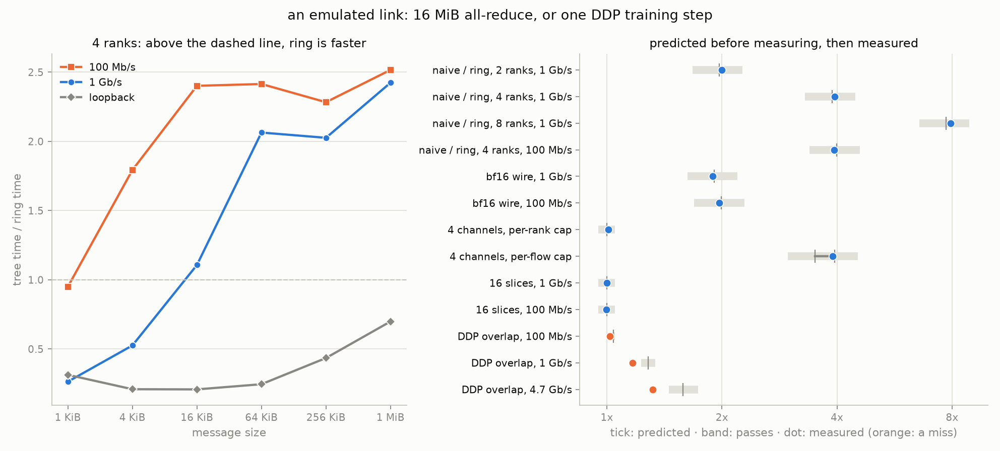

# Emulated links: testing what loopback hides

The README's section [What loopback teaches, and what it
hides](../README.md#what-loopback-teaches-and-what-it-hides) explains four
negative results with one cause: on loopback, "the network" is a memory copy
performed by the same cores that do the reduction, so bytes are never the
expensive part. [docs/multinode.md](multinode.md) then lists what *should*
happen on a real link. None of that had been tested, because it needs a
network.

`mini_nccl.LinkModel` emulates one. This document writes down, with numbers,
what the emulated link should show, **before** anything was measured on it.
Everything above [the results](#the-results) was committed on its own, ahead of
the measurements, so the history shows that these predictions were not fitted
to the results. The pass/fail tolerance was fixed then too, for the same
reason.

## The emulator

A shaped rank sleeps instead of copying, which gives the two properties
loopback lacks: bytes cost time, and the CPU is idle while they move.

- **Rate** (`mbps`): per rank, per direction, shared by every connection and
  channel the rank has. One full-duplex NIC per host.
- **Per-flow rate** (`flow_mbps`): an additional cap per connection, the only
  setting under which "do more channels help?" is a fair question.
- **Latency** (`latency_us`): a fixed delay per send. Not used below; the
  software's own per-step cost (the alpha in the model) is already 60 to
  170 µs, more than a LAN's propagation delay.

Each direction of a link is a clock that books every chunk's serialization
time. An idle link banks no credit, so a small message pays its own delay.
Arrivals are booked as having just finished, so one flow is not charged twice,
but several senders converging on one rank queue on its ingress.

**Calibration** (point-to-point, 2 ranks, best of 5): the emulator delivers
99.5% of nominal at 100 Mb/s, 99.6% at 1 Gb/s and 99.7% at 10 Gb/s. A 1 KiB
message plus a 4-byte acknowledgement takes 173 µs at 100 Mb/s against 82 µs of
serialization, so shaping adds roughly **45 µs per message** of timer and
scheduling overhead. That figure enters the model below as `δ`.

## What this can show, and what it cannot

It can test every prediction that depends on bytes being expensive while the
CPU is free, on links well below what loopback itself can carry.

**Loopback on this machine is not the README's loopback.** The README's
numbers come from a machine whose loopback moved about 0.5 GB/s. Here (Apple
M5, 10 cores, macOS 27.2, Python 3.12, torch 2.15) a 2-rank point-to-point
send moves **5.7 GB/s at 16 MiB and 14.8 GB/s at 64 MiB**, ten to thirty times
more. So the README's premise that loopback is about 22x slower than PCIe is a
property of that machine, not of loopback in general. Every experiment below
therefore also runs unshaped on this machine as a control, and none of the
predictions uses the README's loopback numbers.

It **cannot** test the README's strongest prediction, that pipelining the GPU
staging copies pays once the fabric is within reach of PCIe (about 100 Gb/s).
This machine has no CUDA device, and 100 Gb/s is the speed of loopback itself
here, so there is nothing to emulate it with. That prediction stays on the
roadmap.

Also not modeled: switch contention beyond each host's own link, packet loss
and retransmission, TCP congestion control, latency that overlaps with
transmission, and several ranks sharing one NIC (each rank here has its own).

## The model

Every prediction comes from one formula, with inputs measured unshaped on this
machine:

```
t = steps · (α + δ)  +  bytes_on_critical_path · (β + 1/R)
```

- `α`, `β`: the alpha-beta fit of the unshaped all-reduce sweep
  (`fit_cost_model.py` on `bench_allreduce.py --world-sizes 2,4`):

  | world | algorithm | α per step | β per byte |
  |---|---|---|---|
  | 2 | ring | 166 µs | 0.26 ns |
  | 2 | naive | 50 µs | 0.16 ns |
  | 4 | ring | 148 µs | 0.35 ns |
  | 4 | tree | 66 µs | 0.17 ns |
  | 4 | naive | 26 µs | 0.14 ns |

  There is no 8-rank fit, so 8 ranks reuse the 4-rank values. At 1 Gb/s the
  link term is about 25 times β, so this barely matters.
- `δ` = 45 µs per send, from the calibration above.
- `1/R`: 80 ns per byte at 100 Mb/s, 8 ns per byte at 1 Gb/s.
- Bytes on the critical path, with every rank's link capped in both
  directions: ring `2(W-1)/W · n`; tree `2⌈log₂W⌉ · n`; naive `2(W-1) · n`,
  because rank 0 takes in `W-1` tensors and sends out `W-1` copies of the
  result through one link.

Unless stated otherwise: 4 ranks, ring all-reduce, 16 MiB of float32.

## The predictions

### 1. Naive collapses, by a factor of the world size

Ring moves `2(W-1)/W · n` per rank, all ranks at once; naive moves
`2(W-1) · n` through rank 0. Their ratio is `W`.

| link | ranks | ring | naive | naive / ring |
|---|---|---|---|---|
| 1 Gb/s | 2 | 139 ms | 274 ms | **1.97x** |
| 1 Gb/s | 4 | 211 ms | 820 ms | **3.88x** |
| 1 Gb/s | 8 | 248 ms | 1913 ms | **7.72x** |
| 100 Mb/s | 4 | 2023 ms | 8068 ms | **3.99x** |

On this machine's loopback the same ratio was 1.28x at 2 ranks and 1.10x at 4
(the unshaped sweep above), which is why the README could only say naive
"looks good on loopback".

### 2. The tree/ring crossover moves down by two to three orders of magnitude

Tree wins while its smaller step count matters more than its larger byte
count. Making bytes expensive moves the crossover from megabytes (the model
put it at 3.9 MiB on loopback here, measured 1 MiB) to:

| link | model crossover | first measured size where ring should win |
|---|---|---|
| 100 Mb/s | **3.5 KiB** | **4 KiB**, narrowly: the model gives ring only a 6% edge there |
| 1 Gb/s | **35 KiB** | **64 KiB** (16 KiB: tree ahead, tree/ring 0.72) |

The consequence is the interesting part. `algorithm="auto"` picks tree at or
below 1 MiB, a threshold tuned on loopback. On either link that sends every
message between the crossover and 1 MiB down the slower algorithm. At 1 MiB
the model puts tree at **2.64x** ring's time at 100 Mb/s and **2.43x** at
1 Gb/s.

### 3. A bfloat16 wire finally halves the time

Halving the wire bytes halves the link term. Assuming the per-hop casts cost
about what the saved copying did (which is what the near-1.0x loopback result
implies), the speedup at 16 MiB is:

| link | float32 | bfloat16 wire | speedup |
|---|---|---|---|
| 100 Mb/s | 2023 ms | 1017 ms | **1.99x** |
| 1 Gb/s | 211 ms | 111 ms | **1.91x** |

The README measured 0.95x to 1.28x on its loopback.

### 4. DDP overlap pays most when communication and backward are balanced

Overlap can hide at most the shorter of backward and communication, minus the
last bucket, which only becomes ready when backward ends. Inputs, measured
unshaped on 4 ranks with overlap off (the README's GPT: 4.8M parameters,
0.5 MiB buckets, which gives 37 buckets and 19.15 MB of gradients): forward
55 ms, backward 100 ms, optimizer 16 ms.

Communication per step is `37 · 6 · (α + δ) + 1.5 · 19.15 MB · (β + 1/R)`. The
two are balanced at 4.7 Gb/s, which was computed from those inputs and is
included as a third rate for that reason:

| link | communication | step, no overlap | step, overlap | gain |
|---|---|---|---|---|
| 100 Mb/s | 2351 ms | 2522 ms | 2422 ms | **4.0%** |
| 1 Gb/s | 283 ms | 454 ms | 354 ms | **22%** |
| 4.7 Gb/s | 102 ms | 273 ms | 173 ms | **37%** |

The gain should rise and then fall again. At 100 Mb/s communication dwarfs
everything, so hiding all of backward behind it saves little. This is the same
balanced-stages argument that bounds the device pipelining in the README,
applied to a different pair of stages. The README measured +2% on its
loopback; the unshaped run here is a control, with no prediction made.

### 5. Channels help only when the limit is per flow

| cap at 1 Gb/s | 2 channels | 4 channels |
|---|---|---|
| per rank (one NIC) | **1.00x** | **1.00x** |
| per flow | **1.91x to 1.99x** | **3.50x to 3.94x** |

Under a per-rank cap, extra connections divide the same link, so nothing
changes. Under a per-flow cap each channel brings its own bandwidth. The range
depends on whether the CPU work (`β`) also splits across channel threads
(upper end) or stays serial (lower end). docs/multinode.md's advice that a NIC
"should prefer 4-8" channels is really a statement about per-flow limits.

### 6. Slice pipelining stays useless, for the opposite reason

Pipelining hides the reduction behind the transfer. One core reduces float32
at about 30 GB/s here, so the reduction on ring's critical path is 0.42 ms out
of 211 ms at 1 Gb/s. That makes the ceiling **1.002x at 1 Gb/s and 1.0002x at
100 Mb/s**. On loopback the mechanism lost because the reduction and the
transfer fought over the same cores. On a shaped link the transfer uses no
cores, so it should stop losing, but there is nothing left to win either.

Prediction: **1.00x** at both rates, no gain and no loss. This disagrees with
docs/multinode.md, which says the mechanism "may flip from a loss to a win" on
a NIC. On a slow link it cannot, because the stage it hides is too small to
matter. It could only win on a link fast enough for the reduction to be a
large share of the step time, which is closer to the GPU case this machine
cannot test.

## How the verdicts will be judged

Fixed now, before measuring:

- A ratio or speedup **holds** if the measurement is within **±15%** of the
  predicted value, and **misses** otherwise. For predictions 5 (per-rank cap)
  and 6, which predict 1.00x, it holds if the measurement is within
  **0.95x to 1.05x**.
- The crossover holds if ring first beats tree at the predicted grid size. One
  grid step either way counts as a near miss, and is reported as such. The
  100 Mb/s case is flagged above as marginal.
- For the DDP gain, the prediction that matters is the shape: lowest at
  100 Mb/s, highest at the balanced rate. Each gain is also judged against its
  number at ±15% relative.

Every miss gets an explanation of how big it was and why, rather than a
re-tuned model. The experiments are `benchmarks/bench_emulated_link.py`
(added with the measurements); the unshaped inputs come from its
`--unshaped-inputs` mode and from `bench_allreduce.py` plus
`fit_cost_model.py`.

## The results

Measured on the same machine, the same day, with every experiment in one run:

```bash
python benchmarks/bench_emulated_link.py --ddp-extra-rate 4700   # 194 s
python benchmarks/plot_results.py                                # the chart below
```

Raw times are in `benchmarks/results/emulated_link.csv`. Each time is the
slowest rank's mean over the timed iterations.

| # | prediction | link | predicted | measured | verdict |
|---|---|---|---|---|---|
| 1 | naive / ring, 2 ranks | 1 Gb/s | 1.97x | 2.00x | **holds** |
| 1 | naive / ring, 4 ranks | 1 Gb/s | 3.88x | 3.94x | **holds** |
| 1 | naive / ring, 8 ranks | 1 Gb/s | 7.72x | 7.93x | **holds** |
| 1 | naive / ring, 4 ranks | 100 Mb/s | 3.99x | 3.94x | **holds** |
| 2 | first size where ring beats tree | 100 Mb/s | 4 KiB | 4 KiB | **holds** |
| 2 | first size where ring beats tree | 1 Gb/s | 64 KiB | 16 KiB | **near miss**, one step early |
| 2 | tree / ring at 1 MiB, where `auto` picks tree | 100 Mb/s | 2.64x | 2.52x | **holds** |
| 2 | tree / ring at 1 MiB, where `auto` picks tree | 1 Gb/s | 2.43x | 2.42x | **holds** |
| 3 | bfloat16 wire speedup | 100 Mb/s | 1.99x | 1.97x | **holds** |
| 3 | bfloat16 wire speedup | 1 Gb/s | 1.91x | 1.89x | **holds** |
| 4 | DDP overlap gain | 100 Mb/s | 4.0% | 1.9% | **miss** |
| 4 | DDP overlap gain | 1 Gb/s | 22% | 14.3% | **miss** |
| 4 | DDP overlap gain | 4.7 Gb/s | 37% | 24.1% | **miss** |
| 4 | gain lowest at 100 Mb/s, highest at the balanced rate | | rises with rate | 1.9%, 14.3%, 24.1% | **holds** |
| 5 | 2 / 4 channels, per-rank cap | 1 Gb/s | 1.00x / 1.00x | 1.01x / 1.01x | **holds** |
| 5 | 2 / 4 channels, per-flow cap | 1 Gb/s | 1.91-1.99x / 3.50-3.94x | 2.00x / 3.90x | **holds** |
| 6 | 16 slices vs 1 | 100 Mb/s | 1.00x | 1.00x | **holds** |
| 6 | 16 slices vs 1 | 1 Gb/s | 1.00x | 1.00x | **holds** |

Fourteen of eighteen hold, one is a near miss, and three miss, all of them in
the same prediction. Every prediction that depended only on counting bytes
landed within 5%. Both the near miss and the misses trace back to an input
that was measured once, not to the emulator or the byte arithmetic. [What
the misses have in common](#what-the-misses-have-in-common) is the most useful
part of this document.



### 1. Naive collapses: holds, at every world size

Naive's time is `W` times ring's to within 3% at 2, 4 and 8 ranks, at both
rates. Ring's own time grows only from 135 to 236 ms between 2 and 8 ranks at
1 Gb/s, because its per-rank traffic approaches `2n` and stops growing. Naive
goes from 270 ms to 1.87 s. The unshaped control, run in the same sweep, gives
0.89x, 1.20x and 1.36x, so on this machine's loopback naive is *faster* than
ring at 2 ranks. This is the clearest case of loopback hiding something.

### 2. The crossover moves down by orders of magnitude: holds, with one near miss

At 100 Mb/s ring first wins at 4 KiB, as predicted. At 1 Gb/s it already wins
at 16 KiB (tree/ring 1.11) where the model said tree would still be ahead
(0.72), so the crossover is one grid step below the prediction. The
consequence the prediction was about holds exactly: at 1 MiB, where
`algorithm="auto"` picks tree, tree takes **2.52x** ring's time at 100 Mb/s
and **2.42x** at 1 Gb/s. The loopback control is the opposite: tree wins at
every size up to 1 MiB (0.70 at 1 MiB). On either emulated link, the 1 MiB
threshold is wrong by two orders of magnitude.

**Why the near miss.** Tree's measured times match the model almost exactly
(1.76 ms predicted and measured at 4 KiB, 100 Mb/s). Ring's do not: at small
sizes it runs about twice as fast as modeled. The ring α (148 µs per step)
came from an earlier `bench_allreduce.py` sweep, whose small-message ring
points were slow (0.76 ms at 4 KiB, 1.42 ms at 16 KiB). This run's own unshaped control
measures the same sizes at 0.34 to 0.36 ms, about 60 µs per step. The fit
charged ring for latency it does not have, which pushed the predicted
crossover up. The emulator was not the problem; the input was a noisy run.

### 3. A bfloat16 wire halves the time: holds

1.97x at 100 Mb/s and 1.89x at 1 Gb/s, within 2% of the prediction. The casts
cost so little against a link this slow that halving the bytes halves the
time. The unshaped control gives 1.07x, inside the README's 0.95x to 1.28x.
The README's negative result was a property of loopback, not of the
mechanism.

### 4. DDP overlap: the shape holds, the numbers miss, all three on the low side

The gain rises with link rate as predicted (1.9%, 14.3%, 24.1%) but is a
third to a half below each predicted value. The cause is again an input. The
prediction used a backward pass of 100 ms, from one unshaped run made earlier.
In this sweep backward takes 61 to 68 ms in all eight configurations, and three
fresh `--unshaped-inputs` runs give 61.6, 61.9 and 62.5 ms. The earlier run was
1.3 to 1.6x slower in *every* part (forward, backward, sync, optimizer), which
points to the machine's state during that one run, not to any one component.
Overlap can hide at most the backward time, so the ceiling was overstated by
the same factor of 1.6.

Recomputing the ceiling `min(backward, communication) / step` from each
configuration's own measured parts (an explanation, not a new verdict) gives
2.5%, 15.4% and 32.8%. The first two measurements come within about 1 point
of that. At 4.7 Gb/s the measurement stays 9 points short. There
communication (79 ms) and backward (63 ms) are close to balanced, and the
model's assumption of perfect hiding is at its weakest. The reducer cannot
start before the first bucket is ready, and running it costs backward a few
milliseconds (67 vs 63 ms).

The communication side of the model was accurate where bytes dominate:
285 ms measured against 283 ms predicted at 1 Gb/s. At 4.7 Gb/s it was 79 ms
against 102 ms predicted, which is the same inflated ring α as in prediction 2,
since DDP sends 37 small buckets.

The unshaped control gains **12.1%** here, against the README's +2% on its own
machine. That is a second sign that the README's loopback results describe
that machine's loopback, not loopback in general.

### 5. Channels help only under a per-flow cap: holds

Under a per-rank cap, 2 and 4 channels are both 1.01x of one channel. Under a
per-flow cap they are 2.00x and 3.90x, at the top of the predicted ranges,
which suggests the CPU work split across the channel threads too. "More
channels" is advice about per-flow limits (TCP window, per-connection rate
limits, NICs that hash flows to queues), not about link capacity.

### 6. Slice pipelining: holds, no gain and no loss

0.998x at 100 Mb/s and 1.001x at 1 Gb/s. The unshaped control is still a loss
(0.94x), as on the README's machine. The disagreement with
docs/multinode.md's "may flip to a win" goes this document's way: on a link
slow enough for the transfer to leave the CPU idle, there is nothing left for
pipelining to hide.

## What the misses have in common

Both misses came from inputs measured once: an earlier all-reduce sweep's
small-message points and the one unshaped DDP run. Both were slow outliers,
and each pushed its prediction in a predictable direction. The model was
not re-fitted after the fact, because that would make the predictions
unfalsifiable. The repair belongs upstream: measure the inputs more than once,
in the same session as the experiment. The unshaped controls now run in the
same sweep for that reason, and the gap between the controls and the inputs
is what exposed both misses.

Of the README's four negative results, two turn positive under emulation:
the bfloat16 wire pays 1.9 to 2x, and overlap pays up to 24% when
communication and backward are close to balanced. Slice pipelining stays
neutral, for a reason that can now be stated with a number. The fourth, GPU
staging, is the README's strongest prediction and still needs hardware this
machine does not have. Separately, docs/multinode.md's predictions about
naive, ring and channels hold, with the crossover lower than anyone tuning on
loopback would guess.
